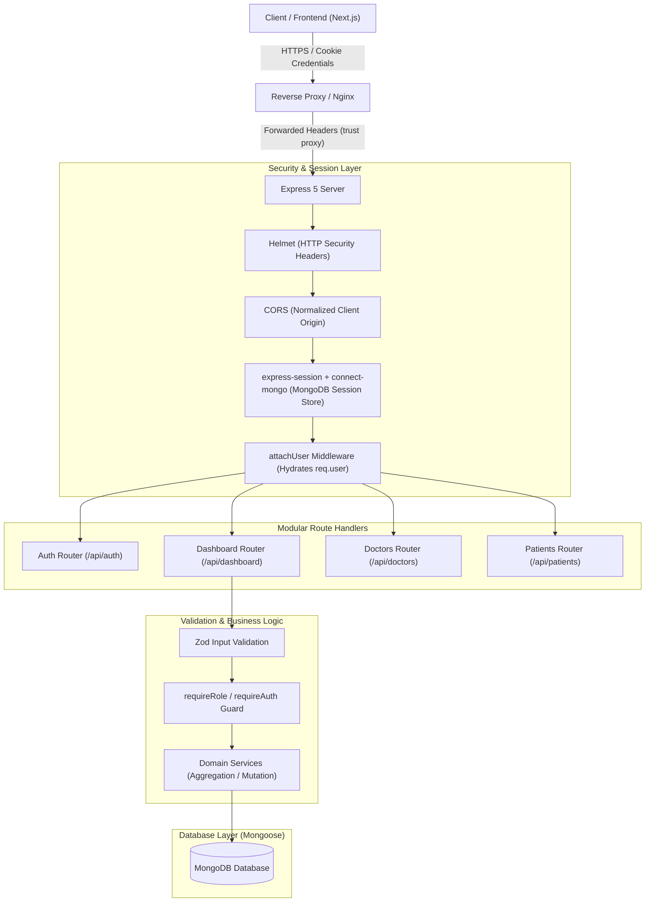

# Doctor Tracker Backend API

## Description
Doctor Tracker Backend is a high-performance, enterprise-grade RESTful API engineered to power modern clinical operations, patient caseload management, and real-time medical staff telemetry. Built on Express 5 and TypeScript with MongoDB, it provides strict role-based access control (Admin vs. Doctor), automated patient-to-doctor assignment workflows, time-series clinical analytics, and hardened session security tailored for multi-domain healthcare environments.

---

## Setup Guide

Follow these step-by-step instructions to set up, configure, seed, and run the backend service locally.

### 1. Prerequisites
- **Node.js**: v20.x or v22.x (v22.x LTS recommended)
- **pnpm**: v9.x or later (`npm install -g pnpm`)
- **MongoDB**: Local MongoDB instance or MongoDB Atlas cluster URI

### 2. Installation
Navigate to the `backend` directory and install project dependencies:
```bash
cd backend
pnpm install
```

### 3. Environment Configuration
Create a `.env` file in the `backend` root by copying the provided `.env.example`:
```bash
cp .env.example .env
```

#### `.env.example` Reference:
```env
# Server Port & Environment
PORT=4000
NODE_ENV=development
CLIENT_ORIGIN=http://localhost:3000

# MongoDB Connection String
MONGODB_URI=mongodb+srv://<db_username>:<db_password>@cluster.mongodb.net/doctor_tracker?retryWrites=true&w=majority

# Session Secrets & Expiration
SESSION_SECRET=change-me-to-a-long-random-string
SESSION_MAX_AGE_DAYS=7

# Seed Admin Credentials (used during `pnpm db:seed`)
SEED_ADMIN_NAME=Admin User
SEED_ADMIN_EMAIL=admin@example.com
SEED_ADMIN_PASSWORD=ChangeMe123!
```

### 4. Database Seeding
Initialize the database with the initial administrator account, sample verified doctors, and active patient profiles:
```bash
pnpm db:seed
```

### 5. Running the Development Server
Start the backend with hot-reload via `tsx`:
```bash
pnpm dev
```
The server will boot at `http://localhost:4000` (or your configured `PORT`).

### 6. Running Integration Tests
Execute the comprehensive Vitest test suite covering authentication, dashboard aggregations, doctors, and patients:
```bash
pnpm test
```

---

## System Architecture

The backend follows a strictly decoupled, modular layered pattern where each domain module (`auth`, `dashboard`, `doctors`, `patients`, `users`) encapsulates its routing, schema validation, and business logic.



### Request Lifecycle
1. **Security & Session Ingestion**: Every incoming request passes through Helmet, origin-validated CORS, and `express-session`. If a session exists, `attachUser` loads the authenticated user profile into `req.user`.
2. **Role & Guard Verification**: Endpoints enforce role isolation via `requireAuth` and `requireRole(["admin", "doctor"])`. Doctors are restricted to accessing and modifying only their assigned caseload.
3. **Zod Validation**: Request bodies and query parameters are parsed and validated strictly with Zod schemas before touching service layers.
4. **Service & Aggregation Execution**: Services communicate with MongoDB using Mongoose models and high-performance aggregation pipelines, returning normalized JSON responses.

---

## Technical Decisions

### Decision 1: Native MongoDB Aggregation Pipelines over In-Memory Processing
- **Context**: Dashboards require multi-dimensional metrics, including 14-day patient admission time-series, condition distribution breakdowns, and patient-per-doctor caseload statistics.
- **Alternative Considered**: Fetching all patient and doctor documents into Node.js application memory and computing totals using JavaScript `Array.reduce` and `Array.filter`.
- **Why We Chose Aggregation Pipelines**:
  - **Memory Efficiency**: In-memory filtering degrades linearly ($O(N)$) as patient counts grow, consuming massive Node.js heap memory and blocking the single-threaded event loop.
  - **Single-Pass Execution**: Utilizing `$facet`, `$group`, `$dateToString`, `$lookup`, and `$unwind` allows MongoDB to compute all timeline buckets and distribution counts in a single database round-trip.
  - **Index Acceleration**: By indexing `{ doctors: 1, createdAt: -1 }` and `{ status: 1 }`, the aggregation engine executes queries in sub-10ms without performing full collection scans.

### Decision 2: HTTP-Only Cross-Site Session Cookies over JWT in LocalStorage
- **Context**: The frontend and backend are hosted on separate domains (e.g., frontend on Netlify, backend on a cloud VPS/server).
- **Alternative Considered**: Bearer JSON Web Tokens (JWT) stored in browser `localStorage`.
- **Why We Chose HTTP-Only Cross-Site Sessions**:
  - **XSS Immunity**: `localStorage` is accessible to client-side scripts, leaving credentials vulnerable to Cross-Site Scripting (XSS) extraction. HTTP-Only cookies cannot be read by browser JavaScript.
  - **Immediate Revocation**: JWTs cannot be revoked without stateful blacklists. With MongoDB session storage (`connect-mongo`), an administrator or user can terminate an active session instantly.
  - **Cross-Domain Delivery**: Configured with `sameSite: "none"`, `secure: true`, and `proxy: true` (behind `trust proxy: 1`), cookies transit across distinct origins reliably while maintaining full CSRF mitigation (`X-Requested-With` header verification and origin checks).

---

## Visual Evidence & API Specification

### Role-Based Access Control (RBAC) Matrix

| Endpoint | Method | Allowed Roles | Description |
| :--- | :--- | :--- | :--- |
| `/api/auth/register` | `POST` | Public | Register new doctor account (Admin self-registration disabled) |
| `/api/auth/login` | `POST` | Public | Authenticate user and initiate session |
| `/api/auth/logout` | `POST` | Authenticated | Destroy active session |
| `/api/auth/me` | `GET` | Authenticated | Fetch current user profile & role |
| `/api/dashboard/admin` | `GET` | Admin only | System-wide statistics, timeline, & doctor workloads |
| `/api/dashboard/doctor` | `GET` | Doctor only | Doctor-scoped patient counts, status, & admissions |
| `/api/doctors` | `GET` | Admin only | List all registered doctors |
| `/api/doctors/:id` | `PATCH` | Admin only | Update doctor status or profile details |
| `/api/doctors/:id` | `DELETE` | Admin only | Deactivate or remove doctor record |
| `/api/patients` | `GET` | Admin, Doctor | List patients (filtered to doctor's caseload for doctors) |
| `/api/patients` | `POST` | Admin, Doctor | Add patient (auto-assigned to self for doctors; any for admin) |
| `/api/patients/:id` | `PATCH` | Admin, Doctor | Edit patient (doctors cannot reassign doctors) |
| `/api/patients/:id` | `DELETE` | Admin, Doctor | Delete patient (doctors can only delete their own patients) |

### Test Suite Coverage
All backend routes and authorization guards are verified by 66 automated integration tests:
```bash
 ✓ tests/auth.test.ts (11 tests)
 ✓ tests/dashboard.test.ts (12 tests)
 ✓ tests/doctors.test.ts (14 tests)
 ✓ tests/patients.test.ts (29 tests)

 Test Files  4 passed (4)
      Tests  66 passed (66)
   Duration  4.12s
```

